# Martin's To Dos — User Guide

## 1. What this is

Martin's To Dos is a desktop to-do list for the small requests that pile up during a working
day: "reply to Anna", "file a ticket for…", "ask Ben about…". You capture each one in seconds
from any app, and date-aware boards show only what matters today. Everything stays on your
computer; there is no account and no sync.

### The 30-second tour

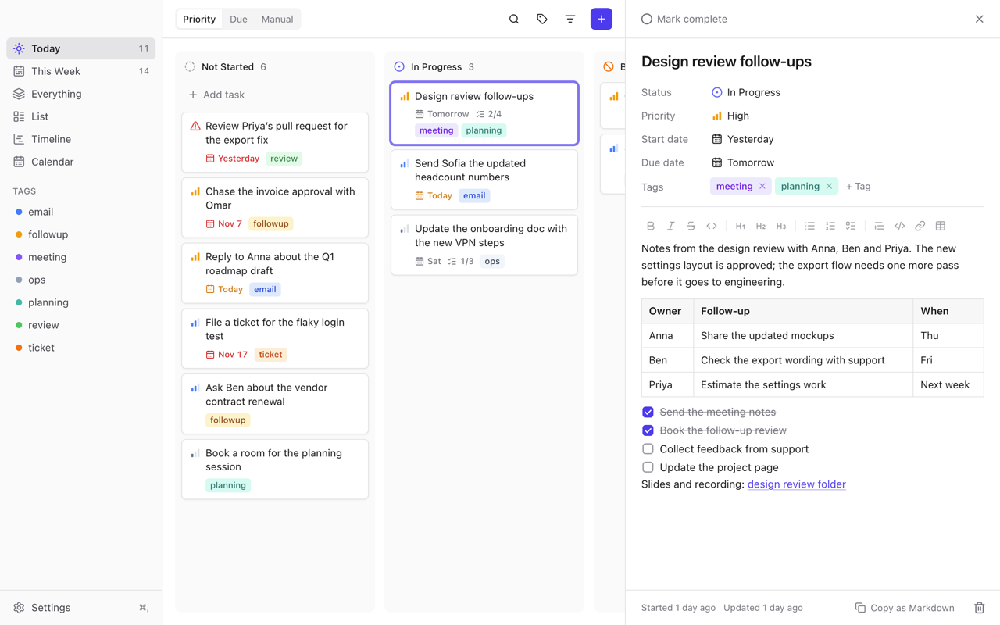

- **Sidebar** (left): the six views — Today, This Week, Everything, List, Timeline, Calendar —
  with the number of open tasks next to Today and This Week. Below them, your tags (click one
  to filter by it) and Settings at the bottom.
- **Toolbar** (top): the view's own controls, search, the Tags and Priority filters and
  **New task**. With the panel open it shrinks to icons, as here.
- **Board** (middle): four columns — Not Started, In Progress, Blocked, Done.
- **Detail panel** (right): opens when you click a task. Everything in it saves as you type.

## 2. Capture a task in seconds

Press `⌥⇧N` (Windows: `Ctrl+Alt+N`) in any app. A small window appears over whatever you are
doing; the main window stays where it is.

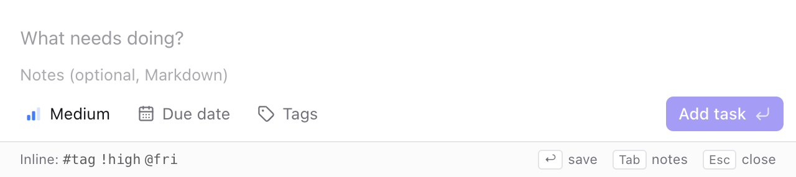

Type a title and press `Enter`: the task goes to Not Started, the window closes and you are
back where you were. `Tab` moves to notes (plain text or Markdown), where `⌘Enter`
(`Ctrl+Enter`) saves. `Esc` closes the window and discards the draft; clicking into another
app closes it but keeps the draft. Set priority, due date and tags with the controls, or type
them into the title:

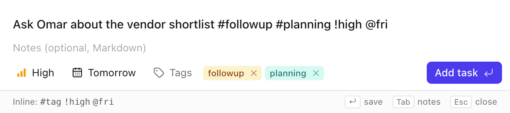

| Type | What it does |
|---|---|
| `#tag` | Adds the tag. A tag that doesn't exist yet is created when you save. |
| `!low` `!med` `!high` `!crit` | Sets the priority (`!1`–`!4` also work). |
| `@today` `@tomorrow` | Due today / tomorrow. |
| `@fri`, `@monday` … | Due on that weekday. |
| `@nov20`, `@2026-12-01` | Due on that date. |

The tokens are removed from the saved title. Rules that surprise people:

- A bare weekday means the next one **after** today: typing `@fri` on a Friday gives next
  Friday. Use `@today` for today.
- An `@word` that isn't a date stays in the title, so "Ask @omar about…" keeps "@omar".
- Digits only is not a tag: `#1234` stays in the title, so ticket numbers are safe.
- If you change a control after typing a token, the control wins.

**Two other ways to add a task** in the main window:

- `⌘N` (`Ctrl+N`) or **New task** opens the same form as a dialog, with a **Start date**
  control and a **Create more** switch; `⇧⌘Enter` (`Ctrl+Shift+Enter`) saves and starts
  another.
- **+ Add task** at the top of Not Started: type a title (tokens work), press `Enter`, and the
  box stays open for the next one.

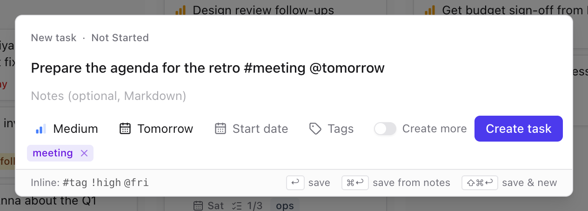

## 3. Work from the Today board

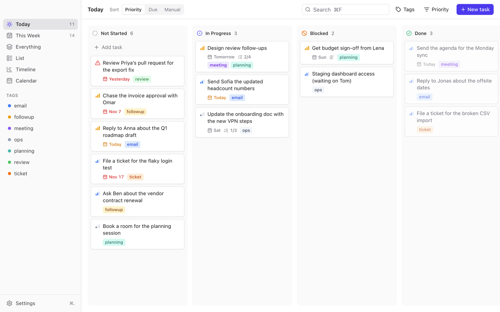

**What Today shows.** Every open task with no dates, plus every open task whose start date —
or, without one, its due date — is today or earlier. Overdue tasks stay until you deal with
them; future work stays hidden. A task due next Friday with no start date does not appear on
Today until that Friday. To see it sooner, give it a start date: it shows up from that day.

**Columns.** Drag a card to another column to change its status (dropping it in the gap
between two columns puts it in the nearer one). Done shows only what you finished today, so it
starts empty each morning.

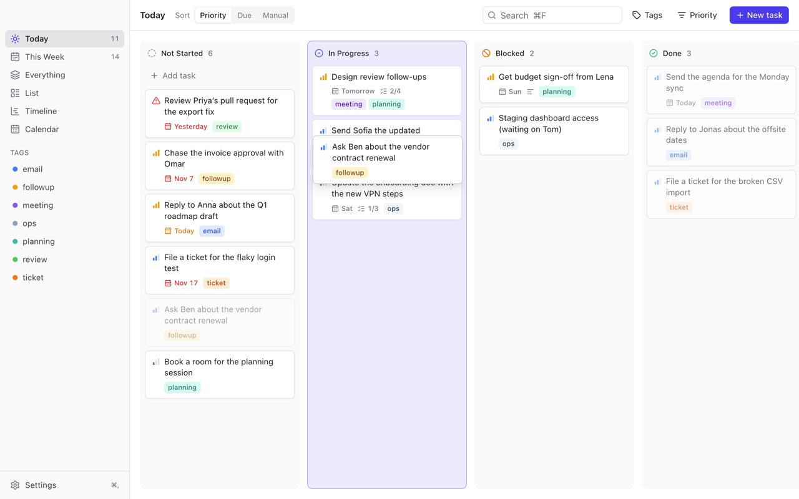

**Sorting.** Use the sort control in the toolbar. Each board remembers its own choice.

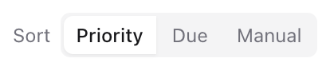

- **Priority** (default): highest priority first, then soonest due date.
- **Due**: soonest due date first, then priority.
- **Manual**: your own order. Only in Manual can you drag a card up or down within a column; in
  the other two modes a drag only changes the column.

**Reading a card.**

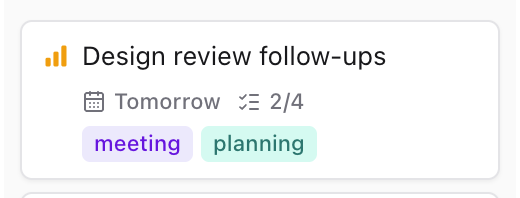

Before the title: the priority (bars for Low to High, a red triangle for Critical). Below it:
the due date (red when overdue, amber when due today) — or, for a task with only a start date,
a grey **Starts …** — checklist progress (`2/4`) or a small lines icon when there is a
description, and the tags in alphabetical order.

## 4. This Week and Everything

These are the same board with a wider window of time.

| Board | Open tasks shown | Done column shows |
|---|---|---|
| Today | Undated, or start/due date today or earlier | Finished today |
| This Week | Undated, or start/due date by the end of this week | Finished this week |
| Everything | All of them, whatever the date | Everything finished, newest first, 50 at a time |

The week starts on Monday; you can change it to Sunday in Settings → General.

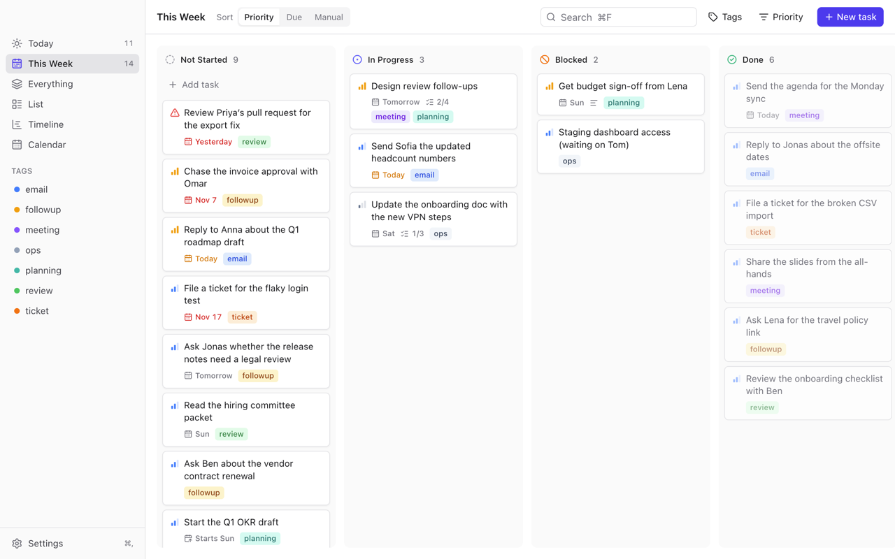

On Everything, the Done column ends with a **Show … more** button when there is more history.

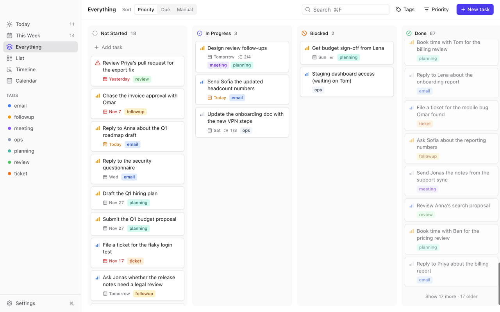

## 5. Open a task

Click a task in any view to open it. The view stays usable underneath; drag the panel's left
edge to resize it, and press `Esc` or × to close it. Clicking empty space in the view (not a
task or a control) closes it too; on the calendar that first click only closes the panel, and
the next click on an empty day starts a new task as usual.

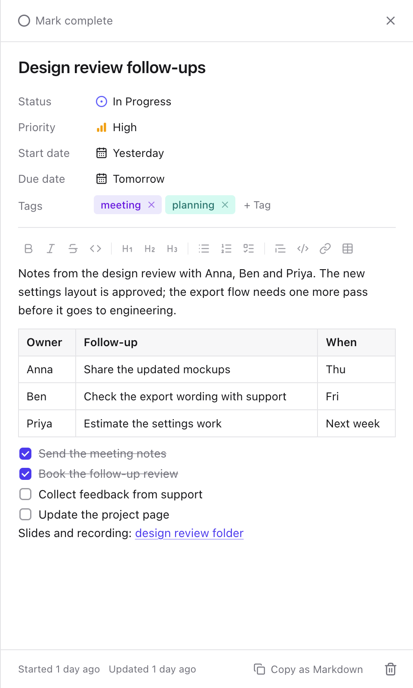

- **Title**, **Status**, **Priority**, **Start date**, **Due date** (the date pickers offer
  Today, Tomorrow, Next week and Clear) and **Tags** (pick one, or type a new name to create
  it).
- **Start vs due**: the due date is the deadline; the start date is when the task should
  appear on Today and This Week. Start can't be after due.
- **Started and completed**: the app notes the moment a task leaves Not Started and the moment
  it reaches Done; you don't enter these. The footer shows **Started**; hover it for every
  timestamp and, for a finished task, how long it took. Moving a task back to Not Started
  clears its start.
- **Description**: use the toolbar or type Markdown: `# ` heading, `- ` bullets, `1. `
  numbers, `[ ] ` checklist, `> ` quote, ```` ``` ```` code block, `**bold**`. The table button
  inserts a table; its menu adds or removes rows and columns. Pasted Markdown becomes
  formatted text. `⌘K` (`Ctrl+K`) adds a link; `⌘`-click (`Ctrl`-click) opens one.
- **Copy as Markdown** (footer) copies the whole task, ready to paste into a chat or ticket.

**Saving.** There is no Save button: fields save when you change them, title and description
half a second after you stop typing. If a save fails, the field keeps your text and shows
**Not saved. Retry**, and the panel stays open until it is saved. If the app closed before it
could save, the field shows **Recovered unsaved text** with **Keep** or **Discard** the next
time you open the task.

**Mark complete** (top left) moves the task to Done; click **Completed** to reopen it (it
goes back to Not Started). The trash icon (bottom right) deletes the task; a **Task deleted**
message with **Undo** appears for a few seconds.

## 6. Stay organised

**Priorities**: Low, Medium (the default), High and Critical, in slate, blue, amber and red
in every view.

**Tags**: click a tag in the sidebar to show only tasks with that tag; click it again to clear
it. Rename, recolour or delete tags in Settings → Tags. Deleting a tag keeps its tasks.

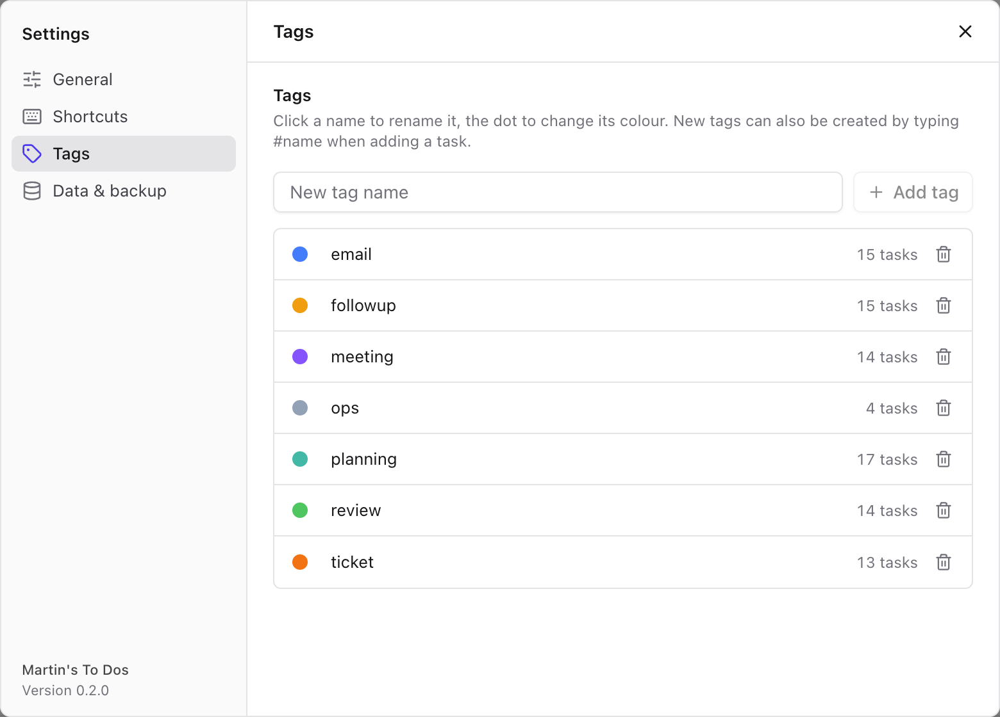

**Search and filters**: `⌘F` (`Ctrl+F`) jumps to search, which matches words in titles and
descriptions. **Tags** and **Priority** in the toolbar filter by one or more values. Filters
apply to whichever view you are on and stay on when you switch views; the × next to them
clears them all.

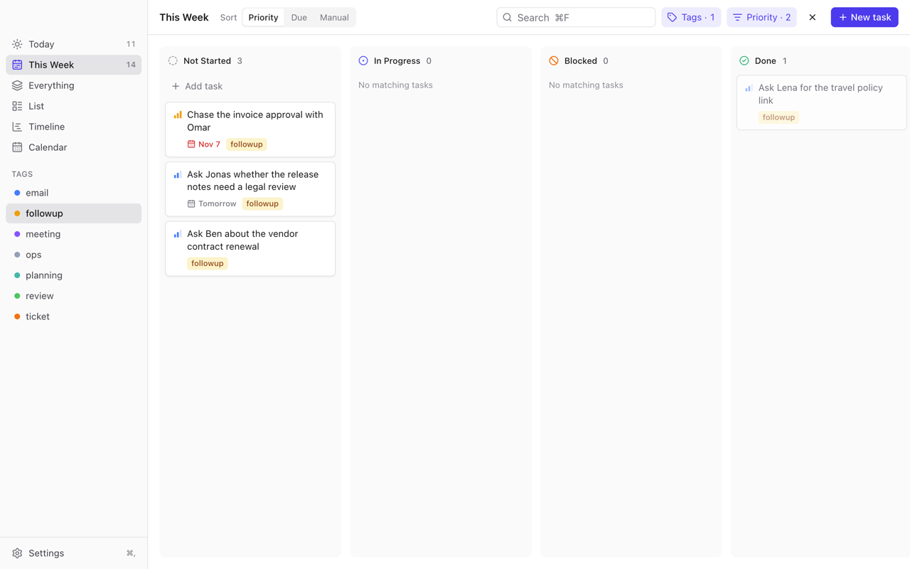

**Right-click** any task for a quick menu: Open, Status, Priority, Due date (Today, Tomorrow,
Next week, Clear) and Delete.

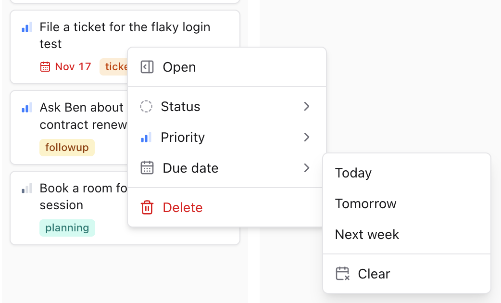

## 7. Plan ahead

**List** shows every task in a table. Click a header to sort; **Group** groups by Status or
Priority; the round status chips show or hide each status. Change status and priority in the
row. `↑`/`↓` move through rows, `Enter` opens one.

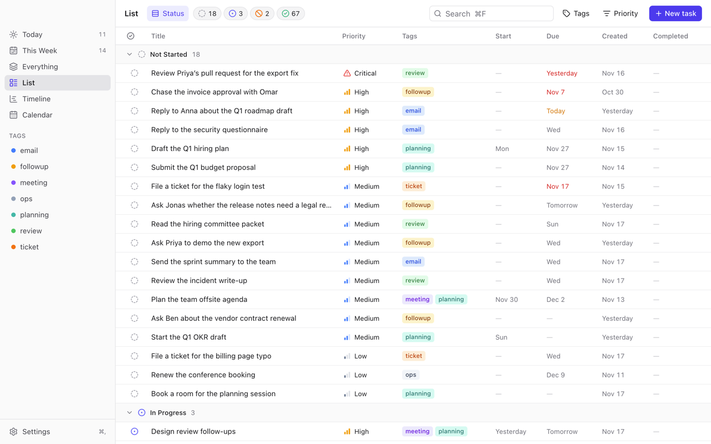

**Timeline** shows tasks as bars, coloured by priority:

- **Not started**: from the start date to the due date (one date = one day). Tasks with no
  dates are not shown.
- **In Progress or Blocked**: from the day you started it up to today, with or without dates.
  If the due date is still ahead, the bar carries on to it, lighter and dashed. Blocked bars
  are hatched.
- **Done** (turn on **Completed**): from the day it was started to the day it was finished.

Hover a bar to see when it started and how long it has been going, or how long it took. Pick
**Day**, **Week** or **Month** zoom; **Today** scrolls back. Drag a not-started bar to move
it, or an end to change its start or due date. On a started bar only the right end drags, and
it sets the due date; finished bars don't move. A long bar's title stays in view when you
scroll past its start. The chart starts a week before today, or earlier if work in progress
began before that (up to a year back): older tasks are pinned to the left edge with their
real date ("due Nov 1"), and overdue titles are red.

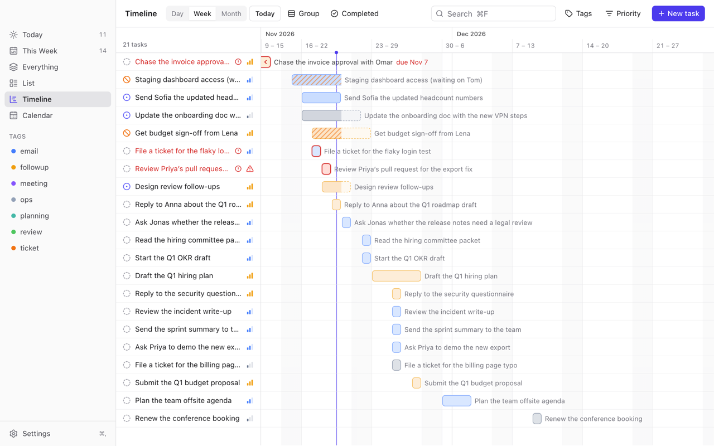

**Calendar** shows a month. Not-started tasks with a start and due date are bars; with one
date they are a single entry on that day. Tasks In Progress or Blocked run from the day you
started them to today (or to the due date, if that is later), with or without dates; Blocked
ones are hatched and carry the Blocked icon. Finished tasks sit on the days they actually ran,
struck through; **Completed** hides them. **+N more** lists the rest of a full day. Drag a
not-started task to another day to move it (multi-day tasks keep their length); started and
finished tasks don't drag. Click an empty part of a day to add a task due then.

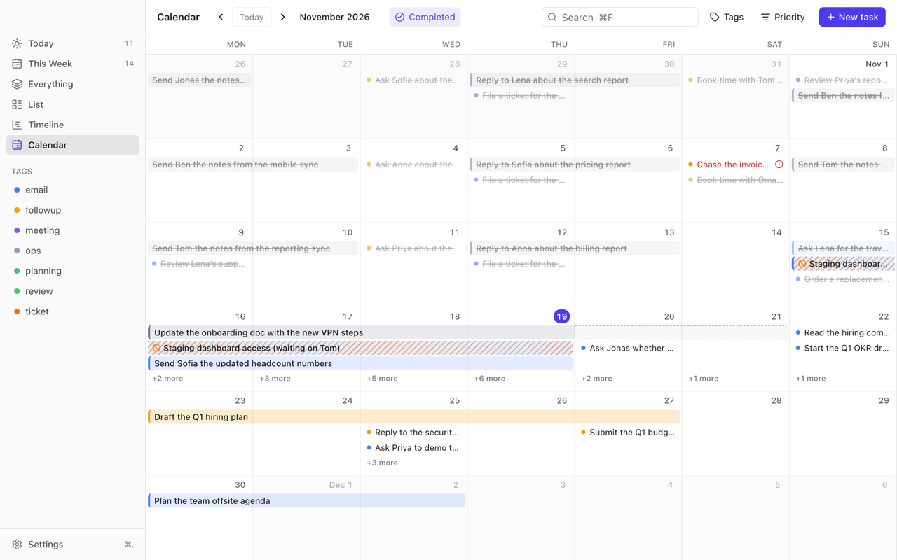

## 8. The app in the background

Closing the window does not quit the app: it keeps running in the menu bar (macOS) or system
tray (Windows), so the quick-add hotkey always works. Its menu has **Open Martin's To Dos**,
**New Task**, **Settings…** and **Quit**; on Windows, clicking the icon shows or hides the
window.

- `⌥⇧T` (`Ctrl+Alt+T`) shows or hides the main window from any app.
- To quit: **Quit** in the menu bar / tray menu, or `⌘Q` on macOS.
- **Launch at login** (Settings → General) starts the app quietly in the menu bar / tray.
- **Appearance** (Settings → General): System, Light or Dark.

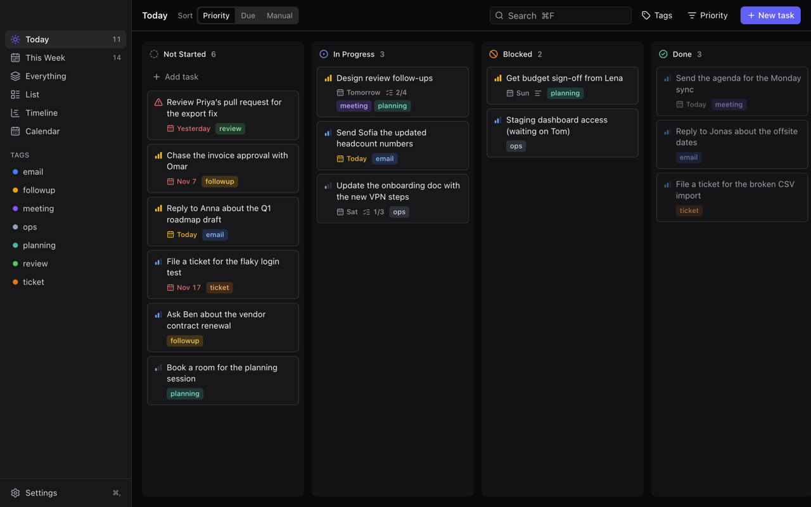

To change a global hotkey, open Settings → Shortcuts, click the shortcut and press the new
combination (`Esc` cancels). The reset button restores the default; × turns the shortcut off.

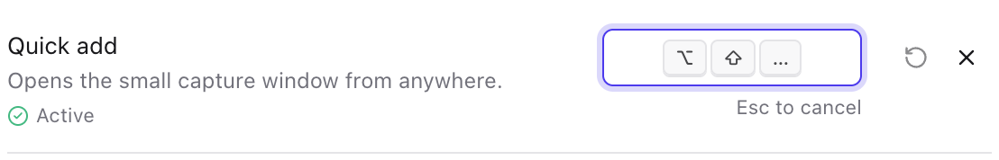

If another app already uses the combination, the field turns red and says **Already in use by
another app or by the system**. Pick a different one. The same goes for a shortcut that stops
working later (say, a newly installed app took it): the next time the main window opens, a
message names the shortcut, with **Change…** to go straight to Settings → Shortcuts. It is
shown once per app run, and never for a shortcut you turned off.

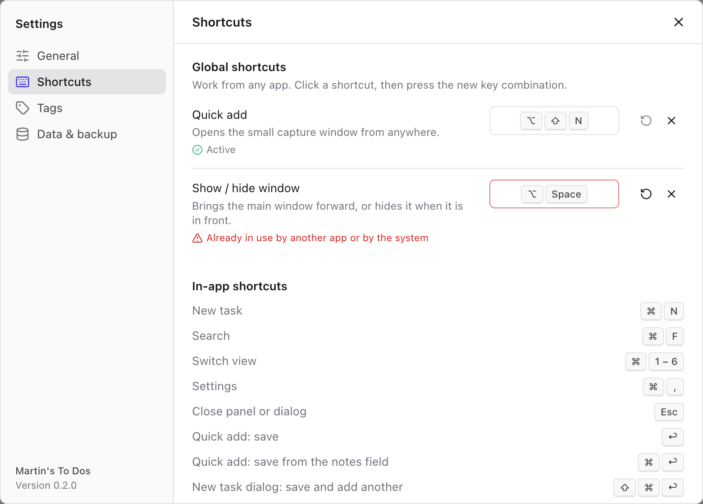

## 9. Your data

Your tasks live in one database file on this computer:

| | Location |
|---|---|
| macOS | `~/Library/Application Support/Martins To Dos/` |
| Windows | `%APPDATA%\Martins To Dos\` |

The database is in `data/todos.db` and backups in `backups/`. Settings → Data & backup →
**Reveal data folder** opens it.

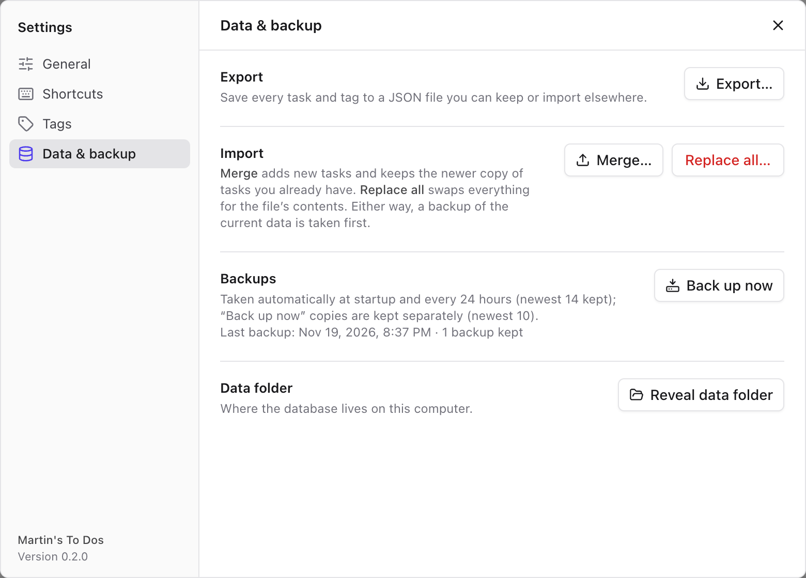

- **Automatic backups** are taken when the app starts and every 24 hours; the newest 14 are
  kept. Nothing is backed up while the list is completely empty.
- **Back up now** makes an extra copy; the newest 10 of these are kept separately.
- **Export…** saves all tasks and tags to one JSON file.
- **Import**: **Merge…** adds tasks from a file and, for tasks you already have, keeps
  whichever copy was edited more recently. **Replace all…** asks for confirmation, then
  replaces everything with the file's contents. Both take a safety backup of your current data
  first (the newest 5 are kept).

**If the database can't be opened** when the app starts, a dialog explains why and what you
can do:

- **Another program is using the file** (another copy of the app, a backup or sync tool):
  close that program and choose **Try again** (as often as needed). **Reveal data folder**
  shows the file and then asks again; **Quit** quits. Your data is fine, so no restore is
  offered.
- **The file is damaged**: **Restore latest backup** (when a backup exists) keeps the bad file
  next to it as `todos.db.broken-…` and starts from the backup; nothing is deleted. If the
  file can't be moved aside, the dialog says so and nothing changes. There are also **Reveal
  data folder** and **Quit**.
- **It was created by a newer version of the app**: **Reveal data folder** or **Quit**.

If the database file is missing but backups exist, you can choose **Restore latest backup** or
**Start fresh**.

## 10. Suggested routines

**In a meeting**

1. Someone asks for something. Press `⌥⇧N`, type it with a token or two —
   `Ask Omar about the vendor shortlist #followup @fri` — and press `Enter`.
2. You're back in the call. Repeat as often as needed; sort it out later.

**Start of day**

1. Open Today (`⌘1`). Look at red due dates first: do them, or right-click → Due date →
   Tomorrow / Next week.
2. Check This Week (`⌘2`) for anything you want to start early, and give it a start date of
   today so it moves onto Today.
3. Drag the two or three things you will actually work on into In Progress. Move anything
   waiting on someone to Blocked.

**Friday review**

1. Open This Week and read the Done column: that is your week.
2. Open Timeline (`⌘5`) or Calendar (`⌘6`) to see what's coming next week.
3. Reschedule by dragging bars or calendar items; drag a bar's end to give a task more time.

## 11. Keyboard shortcuts

| Action | macOS | Windows |
|---|---|---|
| **Global (from any app)** | | |
| Quick add | `⌥⇧N` | `Ctrl+Alt+N` |
| Show / hide window | `⌥⇧T` | `Ctrl+Alt+T` |
| **In the app** | | |
| New task | `⌘N` | `Ctrl+N` |
| Search | `⌘F` | `Ctrl+F` |
| Switch view (Today … Calendar) | `⌘1` … `⌘6` | `Ctrl+1` … `Ctrl+6` |
| Settings | `⌘,` | `Ctrl+,` |
| Close panel or dialog | `Esc` | `Esc` |
| **Quick add and New task dialog** | | |
| Save | `Enter` | `Enter` |
| Save from the notes field | `⌘Enter` | `Ctrl+Enter` |
| Save and add another (dialog) | `⇧⌘Enter` | `Ctrl+Shift+Enter` |
| Move to notes (quick add) | `Tab` | `Tab` |
| **Description editor** | | |
| Bold / italic | `⌘B` / `⌘I` | `Ctrl+B` / `Ctrl+I` |
| Strikethrough / inline code | `⇧⌘S` / `⌘E` | `Ctrl+Shift+S` / `Ctrl+E` |
| Heading 1–3 | `⌥⌘1`–`⌥⌘3` | `Ctrl+Alt+1`–`Ctrl+Alt+3` |
| Bulleted / numbered list | `⇧⌘8` / `⇧⌘7` | `Ctrl+Shift+8` / `Ctrl+Shift+7` |
| Checklist | `⇧⌘9` | `Ctrl+Shift+9` |
| Link | `⌘K` | `Ctrl+K` |
| Open a link | `⌘`-click | `Ctrl`-click |
| Leave the editor (press again to close the panel) | `Esc` | `Esc` |

The global shortcuts can be changed in Settings → Shortcuts; the reset button there restores
the default for your system. (Windows avoids `Alt+Shift` combinations because left
`Alt+Shift` also switches the keyboard layout.)
